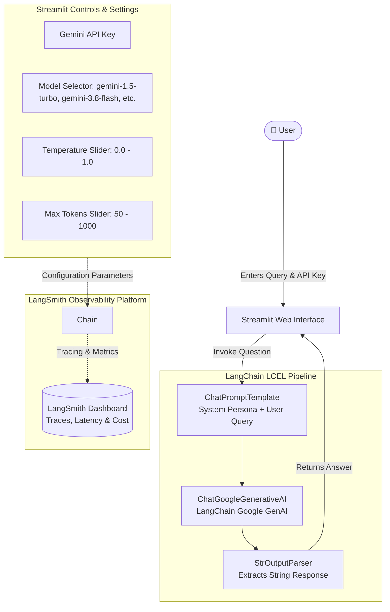

# 🤖 Project 1: Q&A Chatbot with Google Gemini & LangChain

An interactive conversational AI web application built with **Streamlit**, **LangChain Core (LCEL)**, and **Google Gemini** models. This project demonstrates modern LLM integration, dynamic hyperparameter configuration, prompt templating, and full-lifecycle LLM observability with **LangSmith**.

---

## 🏗️ Architecture Diagram



---

## 📌 Detailed Features & Concepts Discussed

### 1. LangChain Expression Language (LCEL)
The project utilizes modern declarative chaining syntax:
```python
chain = prompt | llm | output_parser
```
- **Prompt**: Formats system behavior and user messages into standardized inputs.
- **LLM**: Handles asynchronous and synchronous completions via Google GenAI APIs.
- **Output Parser**: Converts structured chat message outputs directly into clean strings for rendering.

### 2. Multi-Model Support & Parameter Tuning
Users can switch between different generations of Gemini directly from the sidebar:
- `gemini-1.5-turbo`
- `gemini-1.5`
- `gemini-3.8-flash`
- `gemini-3.8`
- `gemini-2.1`
- `gemini-1.0`
- `gemini-1.0-mini`

Adjustable generation parameters:
- **Temperature ($0.0 - 1.0$)**: Controls randomness vs determinism in responses.
- **Max Output Tokens ($50 - 1000$)**: Prevents runaway token consumption and caps response length.

### 3. Production Monitoring with LangSmith
Tracks every LLM run with:
- Token counts (prompt + completion)
- Latency and invocation timestamps
- Full prompt formatting traces
- Environment variables:
  ```env
  LANGCHAIN_API_KEY="your-langchain-key"
  LANGCHAIN_TRACING_V2="true"
  LANGCHAIN_ENDPOINT="https://api.smith.langchain.com"
  ```

---

## 📁 File Structure

```
1-Gemini Chatbot/
├── app.py          # Main Streamlit web application & LangChain pipeline
└── README.md       # Project documentation & architecture
```

---

## 🚀 Setup & Execution Guide

### Prerequisites
1. Python 3.10+ installed.
2. A valid **Google Gemini API Key** from [Google AI Studio](https://aistudio.google.com/).
3. *(Optional)* A **LangSmith API Key** for LLM execution tracing.

### Installation
Ensure dependencies from root are installed:
```bash
pip install -r requirements.txt
```

### Running the Application
From the workspace root directory, run:
```bash
streamlit run "1-Gemini Chatbot/app.py"
```
Or navigate into the directory:
```bash
cd "1-Gemini Chatbot"
streamlit run app.py
```

### Usage
1. Open the local URL (typically `http://localhost:8501`) in your browser.
2. Enter your **Google Gemini API Key** in the sidebar.
3. Select your desired model (e.g. `gemini-1.5-turbo`) and adjust temperature/token limits.
4. Type your question in the text input and press **Enter**.
