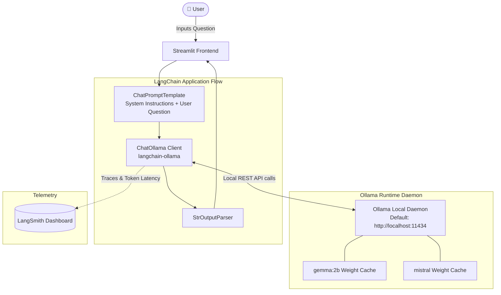

# 🦙 Project 2: Local Q&A Chatbot with Ollama & LangChain

A fully local, privacy-first conversational assistant powered by **Ollama**, **LangChain Core (LCEL)**, and **Streamlit**. It executes open-source LLMs locally on your machine without requiring external third-party API keys or internet access for inference.

---

## 🏗️ Architecture Diagram



---

## 📌 Detailed Features & Concepts Discussed

### 1. Privacy-First Local Inference
- Runs 100% locally on your hardware (CPU or GPU).
- Eliminates cloud subscription costs, rate limits, and data privacy concerns.
- Powered by `langchain-ollama.ChatOllama` communicating with the local Ollama daemon at `http://localhost:11434`.

### 2. Supported Local Open-Source Models
Configurable from the Streamlit sidebar:
- `gemma:2b`: Google's lightweight open-weights model, optimized for low memory usage and fast local inference.
- `mistral`: High-performance 7B parameter foundation model capable of complex reasoning and instruction following.

### 3. Hyperparameter Controls
- **Temperature ($0.0 - 1.0$)**: Balances deterministic outputs with creative generation.
- **Max Output Tokens / `num_predict` ($50 - 1000$)**: Directly maps to Ollama's `num_predict` parameter to constrain local resource consumption.

### 4. Telemetry & Observability
Configured with LangSmith tracing to measure and visualize local token generation speed and chain latency:
```python
os.environ["LANGCHAIN_API_KEY"] = os.getenv("LANGCHAIN_API_KEY")
os.environ["LANGCHAIN_TRACING_V2"] = "true"
os.environ["LANGCHAIN_ENDPOINT"] = "https://api.smith.langchain.com"
os.environ["LANGCHAIN_PROJECT"] = "Q&A Chatbot with Ollama"
```

---

## 📁 File Structure

```
2-Ollama Chatbot/
├── app.py          # Streamlit UI & ChatOllama LCEL pipeline
└── README.md       # Project documentation & architecture
```

---

## 🚀 Setup & Execution Guide

### Prerequisites
1. Install [Ollama](https://ollama.com/) on your operating system.
2. Pull the required models before launching:
   ```bash
   ollama pull gemma:2b
   ollama pull mistral
   ```
3. Verify Ollama is running:
   ```bash
   ollama list
   ```

### Installation
Ensure Python dependencies are installed:
```bash
pip install -r requirements.txt
```

### Running the Application
From the workspace root:
```bash
streamlit run "2-Ollama Chatbot/app.py"
```
Or from the project directory:
```bash
cd "2-Ollama Chatbot"
streamlit run app.py
```

### Usage
1. Open the Streamlit URL (`http://localhost:8501`).
2. Select your installed model (`gemma:2b` or `mistral`) from the sidebar.
3. Tune the temperature and max token sliders.
4. Ask any question and receive locally-generated responses with zero cloud latency.
