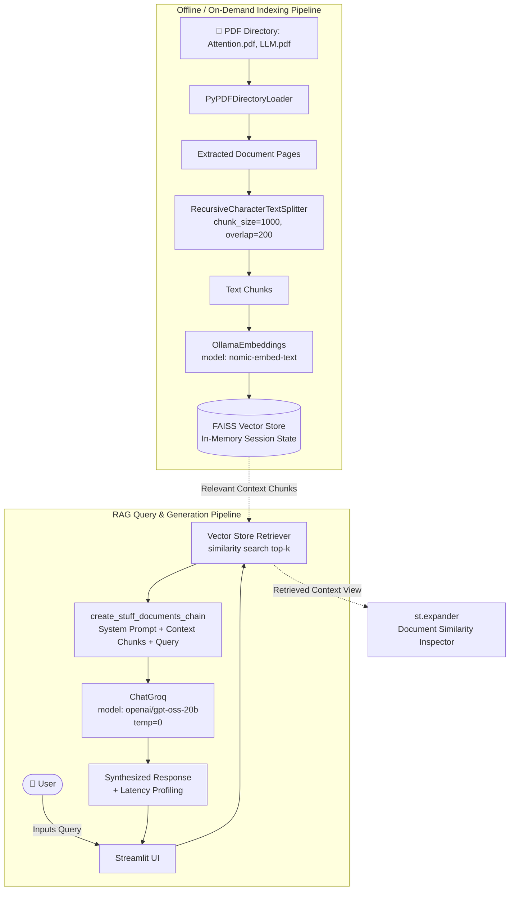

# 📚 Project 3: RAG Document Q&A over Research Papers

A Retrieval-Augmented Generation (RAG) system engineered to ingest, index, and accurately answer user queries grounded exclusively in academic research papers (such as *"Attention Is All You Need"* and foundational LLM literature). It leverages **FAISS**, **Ollama Embeddings**, **LangChain Retrieval Chains**, and ultra-low-latency inference via **Groq**.

---

## 🏗️ Architecture Diagram



---

## 📌 Detailed Features & Concepts Discussed

### 1. Document Ingestion & Chunking
- **Directory Loading**: `PyPDFDirectoryLoader(".")` reads all PDF files located in the target folder in bulk.
- **Recursive Text Splitting**:
  - `chunk_size=1000`: Ensures semantic passages fit well within embedding context windows without losing topical cohesion.
  - `chunk_overlap=200`: Maintains context continuity across chunk boundaries to prevent loss of critical facts split between lines.

### 2. High-Performance Local Vector Embeddings
- Uses `OllamaEmbeddings(model="nomic-embed-text")`.
- `nomic-embed-text` is an 8192-token context length embedding model offering high MTEB benchmark performance, executed locally through Ollama.

### 3. In-Memory Vector Store with FAISS
- Utilizes Facebook AI Similarity Search (`FAISS.from_documents(...)`) for dense vector indexing and cosine/L2 nearest neighbor searches.
- Cached in Streamlit's `st.session_state.vectors` so embedding generation is executed only once per session.

### 4. Strict Grounding Prompt Template
To eliminate hallucinations, the system prompt enforces strict contextual boundaries:
```
Answer the questions based on the provided context only.
Please provide the most accurate response based on the question.
If the answer is not available in the context, say:
"The answer is not available in the provided documents."
```

### 5. Fast Inference with Groq LPU
- Powered by `ChatGroq(model="openai/gpt-oss-20b", temperature=0)`.
- Delivers rapid token generation times (measured and displayed via `time.perf_counter()`).

### 6. Similarity Search Context Inspection
- An interactive `st.expander("Document similarity Search")` allows users and evaluators to inspect the exact document snippets and page contents retrieved by FAISS to verify source attribution.

---

## 📁 File Structure

```
3-RAG Document Q&A/
├── research_papers/
│   ├── app.py              # Main Streamlit application
│   ├── Attention.pdf       # "Attention Is All You Need" (Vaswani et al.)
│   └── LLM.pdf             # Deep learning & LLM survey paper
└── README.md               # Project documentation & architecture
```

---

## 🚀 Setup & Execution Guide

### Prerequisites
1. **Groq API Key**: Obtain a free API key from [Groq Console](https://console.groq.com/).
2. **Ollama**: Ensure Ollama is running with the embedding model installed:
   ```bash
   ollama pull nomic-embed-text
   ```
3. Set your environment variables in `.env`:
   ```env
   GROQ_API_KEY="your-groq-api-key"
   ```

### Running the Application
Navigate into the `research_papers` folder so the loader can access the local PDF files:
```bash
cd "3-RAG Document Q&A/research_papers"
streamlit run app.py
```

### Usage Steps
1. Click the **"Document Embedding"** button to load the PDFs, generate embeddings, and build the FAISS vector index.
2. Wait for the confirmation message: *"Vector Database is ready! ✅"*.
3. Type a query into the text area (e.g. *"What is the self-attention mechanism?"* or *"Explain multi-head attention"*).
4. Review the generated answer, response time latency badge, and expand the **Document similarity Search** section to inspect retrieved sources.
