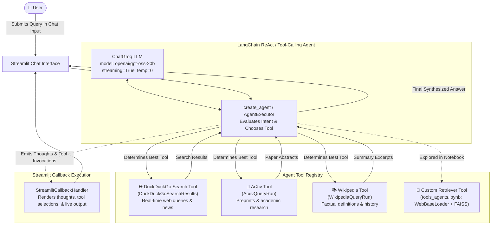

# 🔎 Project 5: Autonomous Multi-Tool AI Search Agent

An autonomous conversational search agent powered by **LangChain Agents**, **Groq LPU**, and **Streamlit**. It dynamically routes user queries across real-time web search (**DuckDuckGo**), academic literature (**ArXiv**), and encyclopedic knowledge (**Wikipedia**), displaying its thought process and tool execution in real-time.

---

## 🏗️ Architecture Diagram



---

## 📌 Detailed Features & Concepts Discussed

### 1. Tool-Calling Agent Architecture
Rather than relying on static prompting, this project implements an autonomous agent using LangChain's `create_agent`:
- The LLM receives tool schemas (name, description, parameters).
- When a prompt is submitted, the agent evaluates which tool best answers the query:
  - Current events / live facts $\rightarrow$ **DuckDuckGo**
  - Scientific papers and preprints $\rightarrow$ **ArXiv**
  - Foundational knowledge & encyclopedic definitions $\rightarrow$ **Wikipedia**

### 2. StreamlitCallbackHandler for Real-Time Thoughts
- Integrates `StreamlitCallbackHandler(st.container(), expand_new_thoughts=False)`.
- Users can view the agent's internal monologue in real-time:
  1. **Thought**: What information is missing?
  2. **Action**: Tool selected and search terms passed.
  3. **Observation**: Raw data returned by the tool.
  4. **Final Response**: Cohesive response generated for the user.

### 3. Deep-Dive Jupyter Notebook (`tools_agents.ipynb`)
The accompanying notebook explores advanced agent topics:
- **Custom Tool Development**: Converting vector store retrievers into tool functions using `create_retriever_tool`.
- **Web Scraping to Vector Index**: Loading live web documentation from `https://docs.smith.langchain.com/` via `WebBaseLoader`, chunking with `RecursiveCharacterTextSplitter`, and building a FAISS index.
- **Classic Agent Toolkits**: Comparing `create_openai_tools_agent` and `AgentExecutor` execution patterns.

---

## 📁 File Structure

```
5-Search Engine/
├── app.py                  # Streamlit agent chat interface with live callbacks
├── tools_agents.ipynb      # Exploration notebook for custom tools, loaders, and agent chains
└── README.md               # Project documentation & architecture
```

---

## 🚀 Setup & Execution Guide

### Prerequisites
1. **Groq API Key**: Obtain a key from [Groq Console](https://console.groq.com/).
2. Install Python dependencies:
   ```bash
   pip install -r requirements.txt
   ```

### Running the Streamlit Search App
From the repository root:
```bash
streamlit run "5-Search Engine/app.py"
```
Or inside the folder:
```bash
cd "5-Search Engine"
streamlit run app.py
```

### Running the Notebook
To experiment with custom tools and agents:
```bash
jupyter notebook "5-Search Engine/tools_agents.ipynb"
```

### Example Test Queries
- **Web Search**: *"What were the top news events in AI this month?"* (triggers DuckDuckGo)
- **Scientific Research**: *"What is the paper 'Attention is all you need' about?"* (triggers ArXiv)
- **General Knowledge**: *"Who was Alan Turing and what were his contributions?"* (triggers Wikipedia)
