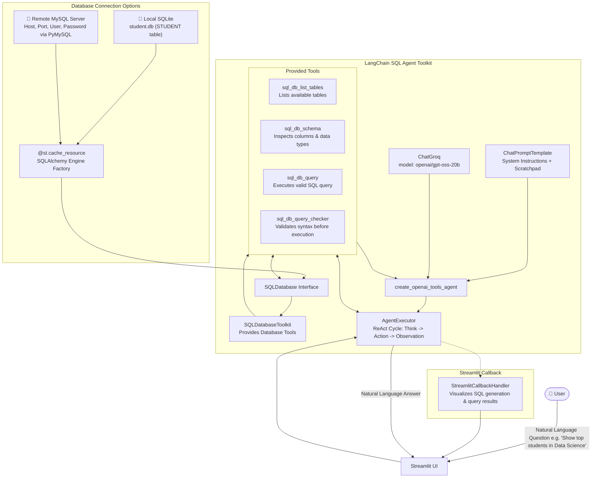

# 🗄️ Project 6: ChatSQL - Conversational Database Agent

A Natural Language to SQL (Text-to-SQL) conversational agent that allows users to query relational databases using everyday English. Built with **LangChain SQLDatabaseToolkit**, **SQLAlchemy**, **Groq LPU**, and **Streamlit**, supporting both local **SQLite** and production **MySQL** databases.

---

## 🏗️ Architecture Diagram



---

## 📌 Detailed Features & Concepts Discussed

### 1. Dual-Database Connectivity
The application accommodates both local development and remote enterprise databases:
- **Local SQLite Mode**: Connects directly to the bundled `student.db` file.
- **MySQL Mode**: Accepts dynamic credentials (Host, Port, Username, Password) and uses SQLAlchemy `URL.create(drivername="mysql+pymysql", ...)` to pool connections to `student_db`.
- **Cached Engine Connection**: Decorated with `@st.cache_resource(ttl="2h")` to reuse engine pools across reruns and prevent socket exhaustion.

### 2. LangChain SQLDatabaseToolkit
Provides four specialized tools to the agent:
1. `sql_db_list_tables`: Discovers existing tables within the schema.
2. `sql_db_schema`: Retrieves DDL schemas, column definitions, and sample rows.
3. `sql_db_query_checker`: Rewrites and verifies queries against common SQL pitfalls.
4. `sql_db_query`: Safely executes read-only SQL queries against the active connection.

### 3. Agent Execution with Live Scratchpad
- Combines `create_openai_tools_agent` and `AgentExecutor` with a `MessagesPlaceholder("agent_scratchpad")`.
- Emits real-time reasoning and query output through `StreamlitCallbackHandler`:
  1. Inspects the schema for table `STUDENT`.
  2. Generates the appropriate SQL query (e.g. `SELECT * FROM STUDENT WHERE MARKS > 75`).
  3. Executes the query and receives raw rows.
  4. Formulates a helpful plain-text response explaining the findings.

### 4. Database Initialization Script (`sqlite.py`)
Includes a standalone SQLite setup script creating the sample `STUDENT` schema and pre-populating records:
```sql
CREATE TABLE STUDENT(
    NAME VARCHAR(25),
    CLASS VARCHAR(25),
    SECTION VARCHAR(25),
    MARKS INT
);
```

---

## 📁 File Structure

```
6-ChatSQL/
├── app.py          # Main Streamlit application with SQL agent & dual-DB connector
├── sqlite.py       # Database generation & seeding script for student.db
├── student.db      # Pre-seeded SQLite database file
└── README.md       # Project documentation & architecture
```

---

## 🚀 Setup & Execution Guide

### Prerequisites
1. **Groq API Key**: Obtain a key from [Groq Console](https://console.groq.com/).
2. Dependencies installed:
   ```bash
   pip install -r requirements.txt
   ```

### 1. Seed or Recreate the SQLite Database (Optional)
If you wish to re-seed `student.db`:
```bash
python "6-ChatSQL/sqlite.py"
```

### 2. Run the Streamlit Application
From the workspace root:
```bash
streamlit run "6-ChatSQL/app.py"
```
Or inside the folder:
```bash
cd "6-ChatSQL"
streamlit run app.py
```

### 3. Usage & Example Questions
1. Choose between **"Use SQLLite 3 Databse-Student.db"** or **"Connect to your SQL Database"** in the sidebar.
2. Enter your **Groq API Key**.
3. Try asking questions such as:
   - *"How many students are enrolled in the Data Science class?"*
   - *"Which student scored the highest marks and in which section?"*
   - *"List all students who belong to the DevOps class with their marks."*
   - *"What is the average marks of all students?"*
4. Expand the thoughts container to view the exact SQL queries generated and executed.
