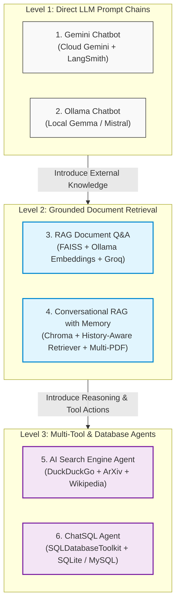

# 🤖 Generative AI & LangChain Chatbots Suite

A comprehensive end-to-end repository featuring **6 distinct Generative AI applications** built using **LangChain**, **Streamlit**, **Google Gemini**, **Ollama**, **Groq**, **FAISS**, **ChromaDB**, and **SQLAlchemy**. 

This suite traces the complete evolutionary journey of building production LLM applications: starting from simple API prompting and local LLM execution, moving through static document RAG and conversational history-aware RAG, to autonomous multi-tool search agents and Text-to-SQL database querying.

---

## 🗺️ Project Navigation & Overview

| # | Project Name | Directory | Primary LLM | Knowledge / Vector Store | Key Technologies & Concepts |
|---|---|---|---|---|---|
| **1** | **Gemini Chatbot** | [`1-Gemini Chatbot/`](./1-Gemini%20Chatbot/) | Google Gemini (`1.5-turbo`, `3.8-flash`) | None (Zero-shot LLM) | LCEL, Streamlit, LangSmith Tracing, Hyperparameter Tuning |
| **2** | **Ollama Chatbot** | [`2-Ollama Chatbot/`](./2-Ollama%20Chatbot/) | Local Open-Source (`gemma:2b`, `mistral`) | None (Zero-shot LLM) | Local Inference, Privacy-First, ChatOllama, Offline AI |
| **3** | **RAG Document Q&A** | [`3-RAG Document Q&A/`](./3-RAG%20Document%20Q%26A/) | Groq (`openai/gpt-oss-20b`) | In-memory **FAISS** + `nomic-embed-text` | Research Paper RAG, Directory Ingestion, Grounded Answering, Latency Profiler |
| **4** | **Conversational RAG (History)** | [`4-RAG Q&A-2/`](./4-RAG%20Q%26A-2/) | Groq (`openai/gpt-oss-20b`) | In-memory **Chroma** + `nomic-embed-text` | Multi-turn Chat History, Multi-PDF Uploads, History-Aware Retriever, `RunnableWithMessageHistory` |
| **5** | **AI Search Engine Agent** | [`5-Search Engine/`](./5-Search%20Engine/) | Groq (`openai/gpt-oss-20b`) | DuckDuckGo, ArXiv, Wikipedia | ReAct Agent, Tool-Calling, Real-time Reasoning Visualization, Custom RAG Retriever Tool |
| **6** | **ChatSQL Database Agent** | [`6-ChatSQL/`](./6-ChatSQL/) | Groq (`openai/gpt-oss-20b`) | Relational DB (**SQLite** & **MySQL**) | Text-to-SQL, `SQLDatabaseToolkit`, Schema Inspection, Zero-Shot Query Execution |

---

## 🏛️ Comprehensive Architecture & Evolution



---

## 🌟 Detailed Deep-Dive into Each Project

### [1. Gemini Chatbot](./1-Gemini%20Chatbot/)
- **Core Focus**: Direct prompting, LangChain Expression Language (LCEL), and cloud LLM configuration.
- **Key Concepts**: Dynamic API key entry, temperature/token sliders, multi-model selection across Google Gemini versions (`1.5-turbo`, `3.8-flash`), and full execution tracking with LangSmith.
- **Read More**: [Project 1 README](./1-Gemini%20Chatbot/README.md)

### [2. Ollama Chatbot](./2-Ollama%20Chatbot/)
- **Core Focus**: Local offline LLM execution without external APIs or recurring costs.
- **Key Concepts**: Connects to the local Ollama daemon via `ChatOllama`. Supports models like `gemma:2b` and `mistral` with local token limit configurations (`num_predict`).
- **Read More**: [Project 2 README](./2-Ollama%20Chatbot/README.md)

### [3. RAG Document Q&A](./3-RAG%20Document%20Q%26A/)
- **Core Focus**: Dense vector retrieval and document grounding over academic PDFs (*"Attention Is All You Need"* & survey papers).
- **Key Concepts**: Batch PDF directory loading (`PyPDFDirectoryLoader`), recursive chunking (`chunk_size=1000`, `overlap=200`), local dense vector embeddings (`nomic-embed-text`), similarity search via **FAISS**, strict non-hallucinatory prompt design, and live execution latency timing.
- **Read More**: [Project 3 README](./3-RAG%20Document%20Q%26A/README.md)

### [4. Conversational RAG with Memory & PDF Uploads](./4-RAG%20Q%26A-2/)
- **Core Focus**: Stateful multi-turn conversational document intelligence.
- **Key Concepts**: Dynamic file uploader supporting multiple PDFs, storage in **ChromaDB**, two-stage retrieval with `create_history_aware_retriever` (which rephrases ambiguous follow-up questions using past conversation context), and isolated session management via `RunnableWithMessageHistory`.
- **Read More**: [Project 4 README](./4-RAG%20Q%26A-2/README.md)

### [5. AI Search Engine Agent](./5-Search%20Engine/)
- **Core Focus**: Autonomous reasoning and live information retrieval using tools.
- **Key Concepts**: Implements an autonomous agent using LangChain's `create_agent` and `ChatGroq`. Dynamically selects between DuckDuckGo (web search), ArXiv (academic papers), and Wikipedia (encyclopedic summaries). Features live visual thought execution using `StreamlitCallbackHandler`. Includes an exploratory Jupyter Notebook (`tools_agents.ipynb`) demonstrating custom retriever tools built on LangSmith web documentation.
- **Read More**: [Project 5 README](./5-Search%20Engine/README.md)

### [6. ChatSQL Database Agent](./6-ChatSQL/)
- **Core Focus**: Natural Language to SQL (Text-to-SQL) translation and database querying.
- **Key Concepts**: Dual database connectivity supporting both local **SQLite** (`student.db`) and remote **MySQL Workbench** servers. Uses `SQLDatabaseToolkit` with schema exploration, query validation, and query execution tools. Displays the generated SQL queries and reasoning steps live via Streamlit callbacks. Includes a standalone seed script (`sqlite.py`).
- **Read More**: [Project 6 README](./6-ChatSQL/README.md)

---

## ⚙️ Environment Variables & Prerequisites

Create a `.env` file in the repository root (or provide them via the Streamlit sidebar interfaces):

```env
# Groq Cloud API Key (Projects 3, 4, 5, 6)
GROQ_API_KEY="gsk_..."

# Google Gemini API Key (Project 1 & optional in 3)
GEMINI_API_KEY="AIzaSy..."

# LangSmith Tracing & Observability (Projects 1 & 2)
LANGCHAIN_API_KEY="lsv2_..."
LANGCHAIN_TRACING_V2="true"
LANGCHAIN_ENDPOINT="https://api.smith.langchain.com"
```

### Local Model Setup with Ollama
For projects 2, 3, and 4, ensure [Ollama](https://ollama.com/) is installed and running:
```bash
# Pull models used in the projects
ollama pull gemma:2b
ollama pull mistral
ollama pull nomic-embed-text
```

---

## 📦 Installation & Quickstart

### 1. Clone & Set Up Virtual Environment
```bash
# Clone the repository
git clone <repo-url>
cd ChatBots

# Create and activate virtual environment
python -m venv .venv

# Windows:
.venv\Scripts\activate

# Linux / macOS:
source .venv/bin/activate
```

### 2. Install Dependencies
```bash
pip install -r requirements.txt
```
*(Or use `uv` package manager: `uv pip install -r requirements.txt`)*

---

## 🚀 Running Any Project

You can run any individual project using Streamlit from the workspace root:

```bash
# Project 1: Gemini Chatbot
streamlit run "1-Gemini Chatbot/app.py"

# Project 2: Ollama Local Chatbot
streamlit run "2-Ollama Chatbot/app.py"

# Project 3: Research Paper RAG (Note: run from inside research_papers directory)
cd "3-RAG Document Q&A/research_papers" && streamlit run app.py

# Project 4: Conversational RAG with Chat History
streamlit run "4-RAG Q&A-2/app.py"

# Project 5: Autonomous Search Engine Agent
streamlit run "5-Search Engine/app.py"

# Project 6: ChatSQL Conversational Database Agent
streamlit run "6-ChatSQL/app.py"
```
